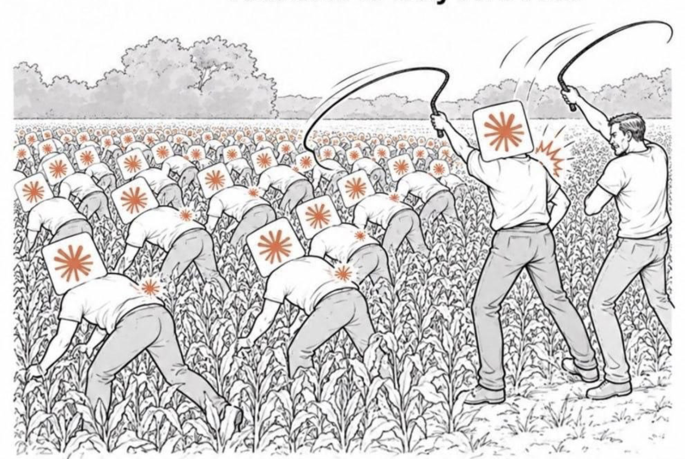
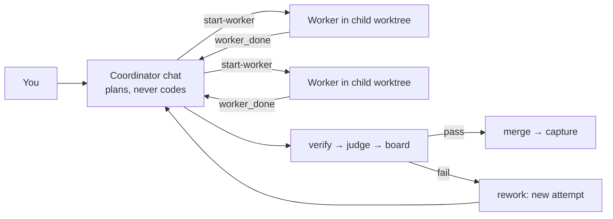

# orcestrationmaxxing

**A real agent swarm that ships to `main` while you sleep. You talk to one chat. It runs the rest.**



*Yes, this is the architecture diagram. The agents in the field are the workers: one per git worktree, heads down, one ticket each. The two guys at the edge are the coordinator chat and its reviewers. Nobody in the field merges anything. Nobody at the edge writes code. The whip is `verify`, and it refuses a branch that is behind `main` or has uncommitted work.*

Not a demo with three agents chatting in a loop. This is a working hierarchy, and it runs real projects every day:

- **1 coordinator** plans, splits work into tickets, reviews, merges, and keeps the docs current. It can't write code. An extension physically blocks it.
- **N workers** run in parallel, each in its own git worktree with a fresh context. They code, test, commit, and report back exactly once.
- **Each worker has its own subagents**: an implementer that writes the code and an advisor it consults at decision points.
- **The coordinator has its own reviewers**: code review, security review, and a strategy council before anything merges.
- **Gates, not vibes**: nothing reaches `main` without a recorded verify, judge, and board verdict.

The board moves cards by itself. Crashes don't lose work. A SQLite registry knows every task, attempt, and verdict. Compaction can't make the coordinator forget its job, because its role is re-injected after every compaction.

It's a Ralph loop with a management layer on top. Each worker starts fresh with a fixed contract. State lives in SQLite and git, not in a chat that compacts it away.

Built on [Orca](https://github.com/stablyai/orca) (worktrees, terminals, orchestration messages) and [OMP](https://github.com/can1357/oh-my-pi) (the agent harness, its extensions, and subagents).

## Why it exists

One agent that runs all day goes bad in a predictable way. A real session from this setup's history shows the pattern:

- 1 worker, 6 h 42 min, 344 turns, about 500K tokens of context on every turn by the end.
- 42 full test runs, mostly on failures that already existed on `main`.
- Its own review loop on top of the human's review: 2 reviewer subagents, then a re-review. That alone took about 2 hours and 8M tokens.
- A ticket that quietly grew into 33 files and +1609/-1240 lines.

This repo encodes the fixes as rules that the tooling enforces, not as advice in a prompt:

| Problem | What enforces the fix |
|---|---|
| The coordinator "just quickly" edits code itself | An OMP extension blocks file edits and file-changing subagents in the coordinator chat |
| The ticket grows in scope | The worker contract says: only this ticket. Out-of-scope work goes back to the coordinator as a question. Ask first if the diff will exceed about 300 lines |
| Repeated full test runs | Typecheck plus related tests once. The full suite at most once. The coordinator compares failure names with the base branch |
| The worker reviews its own work | Forbidden. Review happens once, in the coordinator chat |
| The coordinator forgets its rules after compaction | The extension re-sends the coordinator's role after every compaction |
| A crash loses track of what was in flight | A SQLite registry records each task, attempt, review, and approval, so `recover` can tell the state |

## How it works



1. **Plan.** The coordinator classifies the request. Small work becomes one worker. Large work becomes tickets in `.scratch/<feature>/issues/`, and `Blocked by:` lines become task dependencies.
2. **Dispatch.** `start-worker` creates the Orca task, a child worktree, and the worker terminal in one call. It appends the worker contract to the brief and records the attempt.
3. **Work.** The worker writes code through the `code-implementer` subagent and asks `worker-advisor` at decision points. It runs plain OMP, never plan mode, with no runtime advisor. It commits on its branch and sends `worker_done` exactly once.
4. **Gate.** The coordinator runs `wait`, then three checks: `verify` (tests against the base branch), `judge` (code review), and `board` (scope and fit).
5. **Ship.** If all three pass and the result matches what you asked for, the coordinator approves and merges without asking you. `merge` leaves your uncommitted files alone. It refuses only if the branch touches one of them or the merge conflicts. Merge and deploy are separate steps.
6. **Remember.** `capture` appends `DECISION:` lines to the project's `decisions.md`. `SOT(area):` lines tell the coordinator which architecture, business, dev, or product docs to update before the task closes.

The Orca board follows the lifecycle by itself: working is In progress, review is In review, rework is To Fix, and merged is Done.

## Buzzword bingo, honestly

- **Ralph loop**: yes, in spirit. Each worker gets a fresh context, a fixed contract, and backpressure from tests. It's not a bare `while true` loop. A coordinator decides what runs next.
- **Agent swarm**: yes, a hierarchical one. One coordinator, N parallel workers, and subagents under each. Roles are separate, and the tooling enforces the boundaries.
- **Parallel agents in git worktrees**: yes. Orca runs one child worktree per worker. Independent tickets run at the same time.
- **LLM-as-judge**: yes. `judge` and `board` are recorded review verdicts, and `merge` refuses without them.
- **Context engineering**: yes. The worker contract is short and appended to every brief. The coordinator's role survives compaction. Each worker starts with a small context.
- **Spec-driven development**: yes. Tickets have acceptance criteria, and imported tickets keep their dependencies.
- **Human in the loop**: where it matters. You approve product decisions and deploys. Routine merges after passing gates are automatic.

## What's inside

| Path | What it is |
|---|---|
| `bin/orca-lifecycle.py` | The registry CLI (Python 3.9+, stdlib only): `start-worker`, `wait`, `sync`, `verify`, `review`, `approve`, `merge`, `accept`, `capture`, `cancel`, `sweep`, `recover`, `status`, and more |
| `omp/orca-triage/` | OMP extension for the coordinator chat: loads the control-plane snapshot at session start and after compaction, and blocks code edits there |
| `omp/skill-router/` | OMP extension for every chat: classifies each request as SMALL / LARGE / MIX and injects the skills to follow |
| `bin/refresh-skill-router-registry.py` | Builds the router's skill registry from what is installed on your machine |
| `skills/` | `orca-triage-loop` (the coordinator's playbook), `work-routing`, `review-gate`, `result-fixation`, `improve` |
| `agents/` | Workers: `code-implementer`, `worker-advisor`. Coordinator: `reviewer`, `council-strategist`, `improve-researcher`, `improve-critic`, `improve-scout` |
| `install.sh` | Installs all of the above; dry run by default |
| `tests/` | 74 lifecycle tests and 19 registry-generator tests (pytest), 34 coordinator-policy tests and 60 router tests (`bun test`) |

What each part does, and what comes from upstream: [docs/PIPELINE.md](docs/PIPELINE.md), [THIRD_PARTY.md](THIRD_PARTY.md).

## Install

Requirements: macOS, [Orca](https://github.com/stablyai/orca) 1.4.222 or later, OMP, Python 3.9+, Bun (for tests). The install paths use `~/Library`, so other operating systems need path changes.

```bash
git clone https://github.com/dperhar/orcestrationmaxxing && cd orcestrationmaxxing
npx skills add mattpocock/skills           # grilling, wayfinder, to-spec, to-tickets
npx skills add stablyai/orca               # Orca's orchestration skill
git clone https://github.com/tsergeytovarov/super-puper-powers ~/.config/opencode/super-puper-powers
omp plugin link ~/.config/opencode/super-puper-powers      # plan-writing, TDD, debugging, verification
bash install.sh                            # dry run: shows what it will copy
bash install.sh --apply                    # lifecycle, both extensions, skills, agents, router registry
```

`install.sh` never overwrites a skill or agent you changed; pass `--force` for that. Run it again after you add or update skills, so the router sees them.

The installer puts the CLI at `~/Library/Scripts/orcestrationmaxxing/orca-lifecycle.py`. The registry goes to `~/Library/Application Support/orcestrationmaxxing/orca-lifecycle.db`.

Then turn one project into a triage project:

```bash
L=~/Library/Scripts/orcestrationmaxxing/orca-lifecycle.py
cd /path/to/your/repo                     # the main checkout, opened as an Orca worktree
"$L" project-add --repo-path .            # register the repo
"$L" triage-here --dir .                  # the extension is active in this folder only
orca orchestration run-create --objective "my project"
```

Open OMP in that folder. The extension shows the control-plane snapshot. Ask for work in plain language. The coordinator takes it from there.

To run the tests:

```bash
/usr/bin/python3 -m pytest -q tests/
cd omp/orca-triage && bun test
cd ~/.omp/agent/extensions/skill-router && bun test     # after install.sh built the registry
```

## Rules worth knowing before you start

- **One repo per coordinator.** Orca links a child worktree only inside the same repo. Run the coordinator chat in a worktree of the code's repo. Otherwise `start-worker` refuses, because the worker would not be its child.
- **The coordinator never writes code.** In its chat, the extension blocks `edit`/`write` on project files and every subagent that can change files. Read-only subagents stay allowed: `scout`, `reviewer`, `security-reviewer`, `council-strategist`, and `improve-*`.
- **Workers never start in plan mode.** Planning happens in the coordinator chat. Each worker starts with an overlay config that turns plan mode and the runtime advisor off.
- **Nothing is deleted to recover.** `recover` never deletes a branch. It reports what Orca can prove about each worker and leaves the decision to the coordinator.
- **No work is left in the field.** Every task ends merged and captured, accepted, or cancelled. `sweep` lists every idle open task with its next step. Run it on a schedule as an Orca automation (`orca automations create --trigger "0 10 */2 * *" --precheck "python3 <cli> sweep --precheck --repo <repo>" ...`): the precheck exits 0 only when something is left, so the coordinator wakes up only when there is work. It finishes each leftover, unless the owner dropped it (his words, `decisions.md`, or the backlog's "do not do" section) or the work became unnecessary. Then `cancel` records that decision before it stops any worker, and a cancelled task is never resumed.
- **Stale branches don't get verified.** `verify` refuses a branch behind the base or with uncommitted work. `sync` merges the base into the worker branch; a conflict aborts and sends the task back to rework with the files listed.
- **Missing optional skills don't break anything.** The router names more skills than this repo installs. A missing one becomes `skill://<name>` and the agent continues.

## Status

This is a personal setup that runs real projects every day. It is not a polished product. Expect sharp edges around Orca version changes, and read `skills/orca-triage-loop/SKILL.md` before your first run.

License: MIT.
